# インストーラーによる homepage-v2 のセットアップ画面起動手順

> **対象:** Windows 11（64bit）をお使いの方
> **ゴール:** `http://localhost:3001/setup0` のセットアップ画面を開き、AWS の設定を始められる状態にする
> **所要時間:** ダウンロードを含めて 10〜30 分（回線速度により変動）

インストーラーは「WSL2 イメージの取得 → 取り込み → タスクトレイ常駐」までを自動で行います。
このページは実際の画面（スクリーンショット）に沿って手順を説明します。

---

## 1. インストーラー（zip）をダウンロードする

[Releases ページ](https://github.com/okamoto53515606/homepage-v2-installer/releases/latest) を開き、
`homepage-v2-installer-setup.zip` をクリックして保存します。

> exe を直接配布すると、セキュリティソフトやブラウザの制限でダウンロードできないことがあるため、
> **zip にまとめて配布**しています。中に `homepage-v2-installer-setup.exe` が入っています。

## 2. zip を展開して実行する

保存した zip を右クリック → **「すべて展開」** を選び、展開先のフォルダを開きます。
展開してできた `homepage-v2-installer-setup.exe` をダブルクリックします。

コード署名に対応していないため、Windows の SmartScreen が警告を出すことがあります。
その場合は **「詳細情報」** をクリックします。

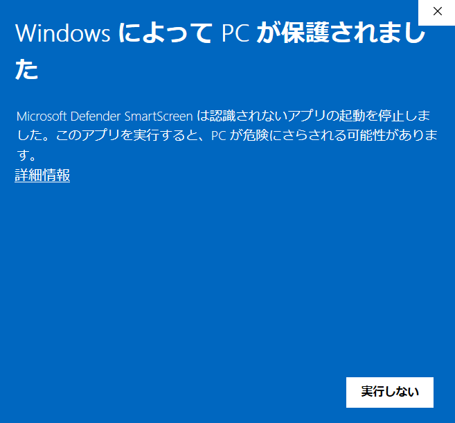

表示された **「実行」** ボタンをクリックするとインストーラーが起動します。

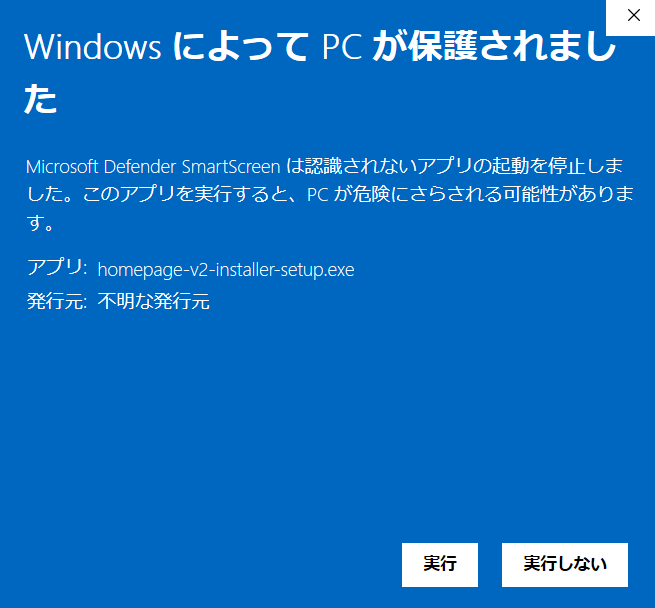

## 3. インストール先を確認する

既定のままで問題ありません。**「次へ」** をクリックします。

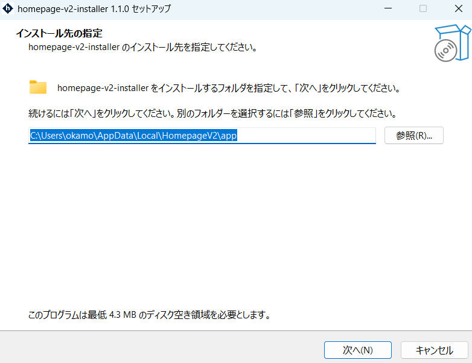

> 既定のインストール先は `C:\Users\<ユーザー名>\AppData\Local\HomepageV2\app` です。
> 変更すると配布物の場所がずれ、サポート時の切り分けが難しくなるため、通常は変更しないでください。

## 4. 追加タスクを選ぶ（任意）

デスクトップにショートカットを作る場合はチェックを入れ、**「次へ」** をクリックします。

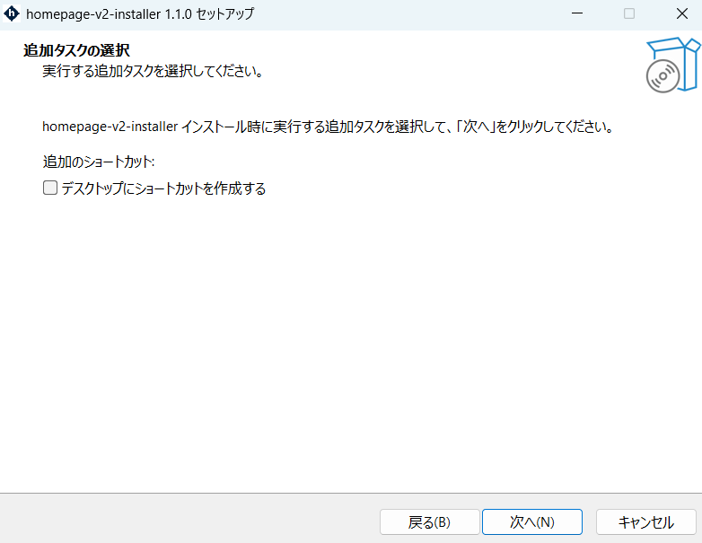

## 5. インストールを開始する

設定内容を確認し、**「インストール」** をクリックします。

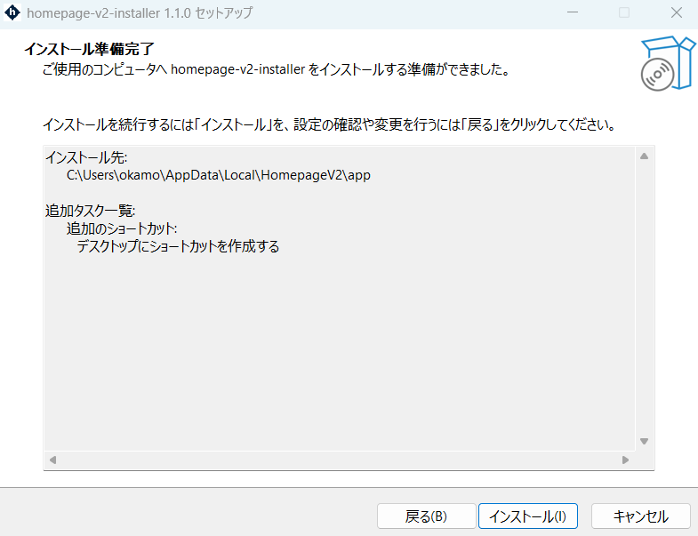

WSL イメージ（gzip 圧縮済み・約 1.1GB）のダウンロードが始まります。
回線速度によっては数分〜数十分かかります。

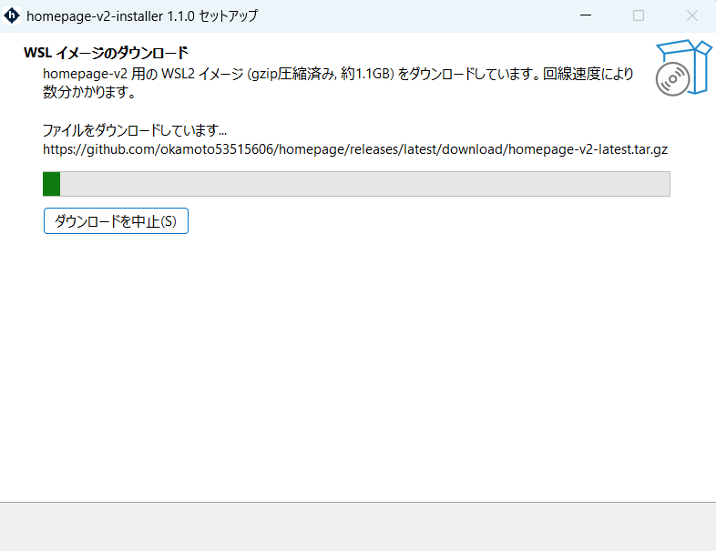

ダウンロード後は自動で次の処理が進みます。

1. SHA256 の検証（壊れたダウンロードを検出したら中止）
2. `wsl --import` による取り込み（ディストリ名: `homepage-v2-latest`）
3. タスクトレイアプリの配置

> **WSL2 が未導入の PC では**、同意のうえで `wsl --install --no-distribution` が UAC 昇格で実行されます。
> その場合は再起動を求められることがあります。案内に従って再起動し、インストーラーを再実行してください。

## 6. インストールを完了する

**「完了」** をクリックします。「homepage-v2-installer を起動する」にチェックが入っていれば、
そのままタスクトレイに常駐します。

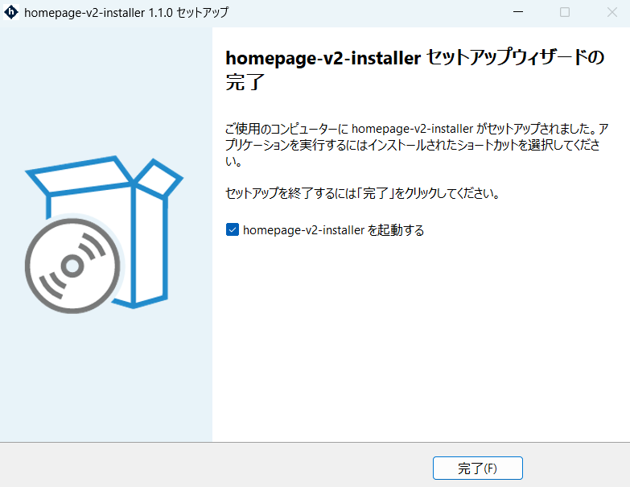

デスクトップにショートカットを作成した場合は、次のアイコンが追加されます。

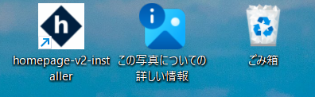

タスクトレイに homepage-v2 のアイコンが表示されていれば準備完了です。

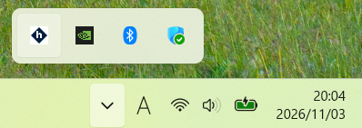

## 7. セットアップ画面を開く

タスクトレイのアイコンを右クリックし、**「起動 (npm run dev)」** を選びます。

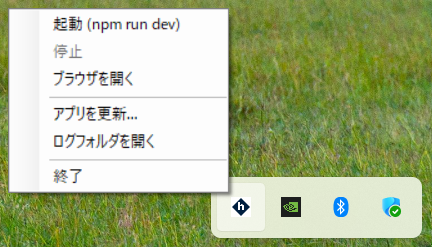

数十秒〜最大 10 分待つと、ブラウザが自動で開き、`http://localhost:3001/setup0` が表示されます。

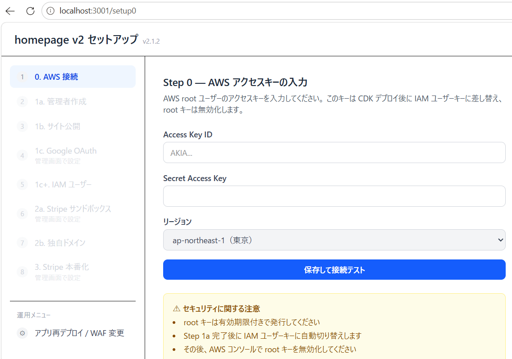

ここから本セットアップが始まります。まずは **Step 0「AWS アクセスキーの入力」** で
AWS のアクセスキーを登録してください。

> 起動中はタスクトレイのメニューで **「停止」** が選べるようになります。
> 作業を終えたら **「停止」** を選ぶとサーバーが止まります（PC の電源を切っても停止します）。

---

## うまくいかないとき

| 症状 | 対処 |
|---|---|
| SmartScreen でブロックされる | 「詳細情報」→「実行」をクリック |
| インストール中に「再起動してください」と出た | 案内に従って再起動し、インストーラーを再実行 |
| ダウンロードが失敗する | エラー画面の「リトライ」。次回以降は `%LOCALAPPDATA%\HomepageV2\cache` があればダウンロードをスキップ |
| 「起動」を押してもブラウザが開かない | 最大 10 分ポーリングします。開かない場合はトレイ → 「ログフォルダを開く」で `tray.log` を確認 |
| ポート 3001 が使用中 | 他のアプリを停止してから「起動」 |
| その他の不調 | トレイ → 「ログフォルダを開く」→ `%LOCALAPPDATA%\HomepageV2\logs` の `install-*.log` / `tray.log` を確認 |

## 関連ドキュメント

- アプリの更新手順: [installer-update.md](installer-update.md)
- 利用者向けの概要・トラブルシューティング: [README](../README.md)
