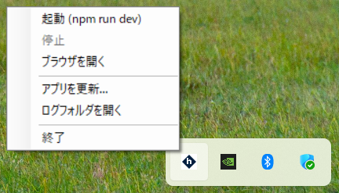
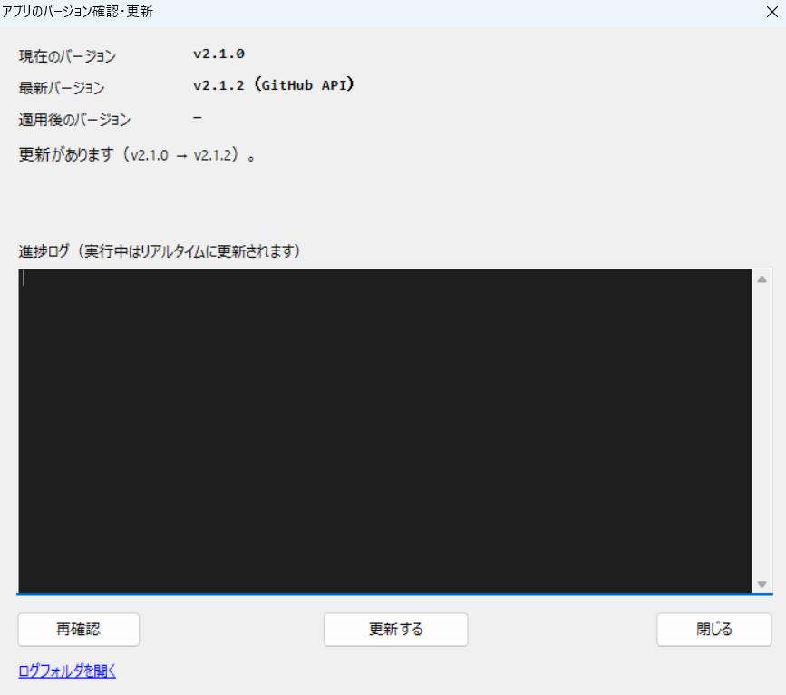
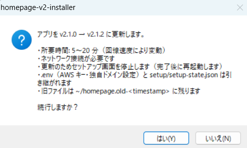
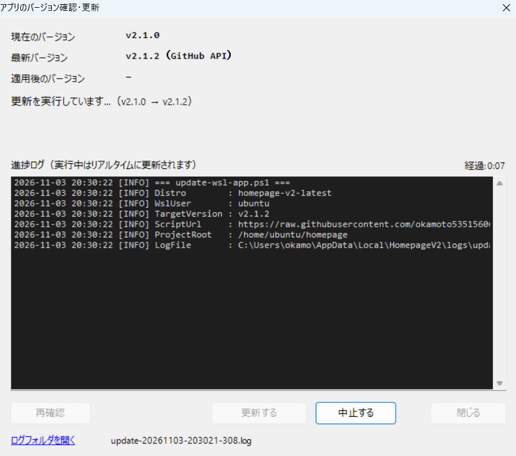
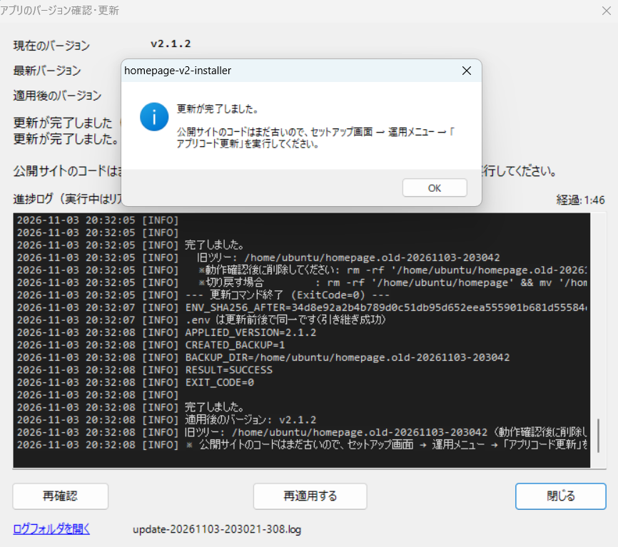
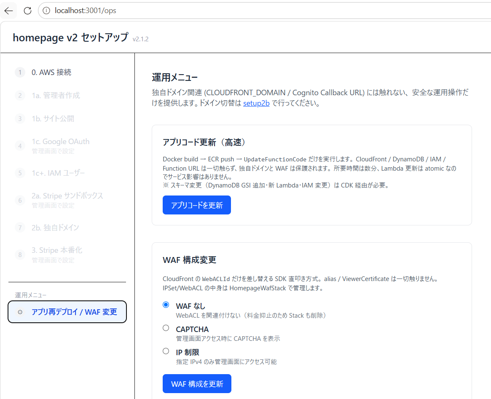

# インストーラーによるアップデート手順

> **対象:** homepage-v2-installer で導入済みの方
> **所要時間:** 5〜20 分（`next build` を含むため回線・PC 性能により変動）
> **必要なもの:** インターネット接続（WSL 内で GitHub から取得します）

このページは、タスクトレイの **「アプリを更新...」** で WSL 内のアプリ（`~/homepage`）を
最新版に差し替える手順を、実際の画面（スクリーンショット）に沿って説明します。

## 更新の考え方

| 更新したいもの | 方法 |
|---|---|
| WSL 内のアプリ（セットアップ画面のコード） | **トレイ →「アプリを更新...」**（このページ） |
| 公開サイトのコード（AWS 上で動いているもの） | セットアップ画面 → 運用メニュー → **「アプリコード更新」** |
| インストーラー本体 | 新しい `homepage-v2-installer-setup.zip` を展開し、中の `homepage-v2-installer-setup.exe` で上書きインストール |

> トレイの更新は **WSL 内のファイルを差し替えるだけ** です。公開サイトのコードは別途、
> 運用メニューの「アプリコード更新」で反映してください。

---

## 1. 「アプリを更新...」を開く

タスクトレイのアイコンを右クリックし、**「アプリを更新...」** を選びます。



## 2. バージョンを確認する

現在のバージョン（`~/homepage/package.json`）と最新バージョン（GitHub Releases の最新タグ）が
表示されます。更新がある場合は **「更新があります」** と表示され、**「更新する」** が押せる状態になります。



| 表示 | 意味 |
|---|---|
| 現在のバージョン | WSL 内のアプリの版 |
| 最新バージョン | GitHub の最新タグ（取得できないときは「不明」） |
| 適用後のバージョン | 更新後の版（更新前は「—」） |
| 「最新です」 | すでに最新。必要なら「再適用（修復）」が可能 |
| 「更新があります」 | 「更新する」を押す |

## 3. 実行を確認する

**「更新する」** を押すと確認ダイアログが出ます。内容を確認して **「はい」** を選びます。



ダイアログに表示される重要事項:

- 所要時間は 5〜20 分（回線速度により変動）
- **ネットワーク接続が必要**
- 更新のためにセットアップ画面を停止します（完了後に再起動します）
- **`.env`（AWS キー・独自ドメイン設定）と `setup/setup-state.json` は引き継がれます**
- 旧ファイルは `~/homepage.old-<timestamp>` に残ります

## 4. 進捗を待つ

実行中はログがリアルタイムで流れ、経過時間が表示されます。**「中止する」** で途中停止もできます
（30 分でタイムアウトします）。



## 5. 完了を確認する

完了すると「適用後のバージョン」が表示され、ログに `RESULT=SUCCESS` / `APPLIED_VERSION=<版>` が出ます。



完了ダイアログには **「公開サイトのコードはまだ古いので、セットアップ画面 → 運用メニュー →
「アプリコード更新」を実行してください」** と表示されます。次の手順に進んでください。

## 6. 公開サイトへ反映する

セットアップ画面の左下 **「運用メニュー」** を開き、**「アプリコード更新」** を押します。



> この操作は Docker ビルド → ECR push → Lambda のコード差し替えのみを行います。
> CloudFront / DynamoDB / IAM / WAF には触れず、独自ドメイン設定は保持されます（数分で完了）。
> **スキーマ変更（DynamoDB の GSI 追加、新しい Lambda、IAM 変更）を伴う版では、
> この操作では反映されません。** その場合は従来どおり再デプロイ（`setup1b`）が必要です。

---

## 更新後の確認（任意）

PowerShell から状態を確認できます。

```powershell
# バージョンと退避ディレクトリ、.env のハッシュ
wsl -d homepage-v2-latest -u ubuntu -- bash -lc 'head -4 ~/homepage/package.json; ls -d ~/homepage.old-* 2>/dev/null; sha256sum ~/homepage/.env'
```

| 見るもの | 期待値 |
|---|---|
| `package.json` の `version` | 更新先の版（例 `2.1.2`） |
| `~/homepage.old-<timestamp>` | 存在（切り戻し用。確認後に削除してよい） |
| `.env` の SHA256 | 更新前と同じ |

退避ディレクトリの削除:

```powershell
wsl -d homepage-v2-latest -u ubuntu -- bash -lc 'rm -rf ~/homepage.old-*'
```

## 失敗したとき

| 症状 | 対処 |
|---|---|
| 更新に失敗した | 画面の「原因」とログを確認。旧ツリーは `~/homepage.old-<timestamp>` に残っています |
| 更新前に戻したい | 画面に表示される切り戻しコマンドを実行（`rm -rf ~/homepage && mv ~/homepage.old-<timestamp> ~/homepage`） |
| 「最新です」のまま更新できない | ネットワークを確認し「再確認」。`%LOCALAPPDATA%\HomepageV2\logs\tray.log` の `CurrentVersion=` / `LatestTag=` を確認 |
| 更新ボタンが押せない | 未セットアップ（`~/homepage` 不在）、または最新バージョンを取得できていません |
| 更新後の画面が古い | セットアップ画面 → 運用メニュー → 「アプリコード更新」を実行 |
| その他 | トレイ →「ログフォルダを開く」→ `%LOCALAPPDATA%\HomepageV2\logs\update-*.log` |

- 更新は二重実行できません（実行中はロックされます）。
- ログは `%LOCALAPPDATA%\HomepageV2\logs\update-<日時>.log` に保存されます。

## 関連ドキュメント

- 新規インストール手順: [installer-setup.md](installer-setup.md)
- 利用者向けの概要・トラブルシューティング: [README](../README.md)
