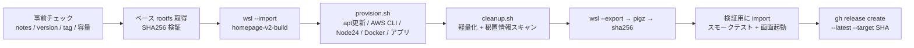

# 配布用 WSL イメージの自動ビルド

> **why:** 従来の手作業（クリーン Ubuntu 作成 → ツール導入 → 軽量化 → export → 圧縮 → リリース）は
> 1 回 40〜60 分かかり、しかも手順の抜け・版ズレ・秘密情報混入が起こりやすい。
> `tools/build-wsl-image.ps1` はこの一連を 1 コマンドにまとめ、**リリース前の検証まで自動で通す**。

## 0. リリースノートの置き場所（最初にやること）

本体リポジトリ `okamoto53515606/homepage` の `package.json` の `version` を更新して push したあと、
次のパスにリリースノートを置く。

```text
D:\wsl_backup\homepage-release-notes-v<version>.md
```

例（`package.json` の version が `2.1.2` のとき）:

```text
D:\wsl_backup\homepage-release-notes-v2.1.2.md
```

| ルール | 内容 |
|---|---|
| ファイル名の `<version>` | 本体 `package.json` の `version` と**完全一致**（`v` は付けない） |
| リリースタグ | 自動で `v<version>`（例: `v2.1.2`）になる |
| 本文 | そのまま GitHub Release の本文になる（`update_v2.md` §6 の「押すボタン」案内を書く） |
| 旧形式の互換 | `D:\wsl_backup\release-notes-v2.1.2.md` でも可 |
| 任意パス | `-NotesFile <path>` で明示指定も可 |

`-Version` を省略した場合は、`D:\wsl_backup` 内の
`homepage-release-notes-v*.md` / `release-notes-v*.md` のうち**最も新しいバージョン**から自動決定する。

## 1. 実行

> **手順を 1 つずつ追いたい場合**は [wsl-image-release-runbook.md](./wsl-image-release-runbook.md)（チェックリスト・失敗時の後始末付き）。
> 引数なしで実行すると **公開（`gh release create --latest`）まで**進む。公開を止めるのが `-SkipRelease`。

```powershell
cd D:\work\homepage-v2-installer
.\tools\build-wsl-image.ps1
```

検証だけしてリリースは手動でしたい場合:

```powershell
.\tools\build-wsl-image.ps1 -SkipRelease
```

### 前提

| 項目 | 要件 |
|---|---|
| WSL | 2.x（`wsl --version` が通る。今回は 2.7.3 で検証） |
| gh CLI | インストール済み + `gh auth login` 済み（`-SkipRelease` なら不要） |
| 空き容量 | `D:\` に 20GB 以上（中間 tar が数GB） |
| ネットワーク | cdimages.ubuntu.com / GitHub / Docker / AWS CLI / nvm |

Inno Setup や ps2exe は不要（このスクリプトは WSL イメージ専用。インストーラ .exe は従来どおり `build.ps1`）。

## 2. 何が自動化されるか



従来の手作業（`wsl --install` から始める旧手順）との対応:

| 従来の手順 | 自動化での扱い |
|---|---|
| 1. `wsl --install` + 対話ユーザー作成 | **廃止**。公式 rootfs を `wsl --import` し、`useradd ubuntu` を非対話で実行（既存 Ubuntu を汚さない） |
| 2. `visudo` で NOPASSWD | `/etc/sudoers.d/99-homepage` に直接書き、`visudo -cf` で構文検証 |
| 3. ツール導入 | `provision.sh`（`DEBIAN_FRONTEND=noninteractive`） |
| 4. 軽量化 | `cleanup.sh`（順序は 更新 → ビルド → purge → 掃除） |
| 5. リポジトリ取得 + ビルド | `fetch-app.sh --fresh --dist` を main から取得して実行 |
| 6. 実行ビット確認 | `chmod +x` + `verify.sh` で検証 |
| 7. 起動テスト | 検証用 distro に import して `start.sh` → `http://localhost:3001/setup0` が 200 になるまでポーリング |
| 8. export | `wsl --export` → `homepage-v2-latest.tar` |
| 9. 圧縮 + sha256 | `pigz -9 -p $(nproc)` + PowerShell で SHA256（`make-sha256.ps1` と同じ 64 桁 1 行形式） |
| 10. `gh release create` | `--latest` / `--target <main の SHA>` 付きで自動実行（**旧手順は `--latest` が抜けていた**） |

## 3. パラメータ

| パラメータ | 既定 | 説明 |
|---|---|---|
| `-Version` | ノートから推定 | `2.1.2` / `v2.1.2` どちらでも可 |
| `-NotesDir` | `D:\wsl_backup` | ノート探索ディレクトリ |
| `-NotesFile` | （自動解決） | ノートを明示指定 |
| `-WorkDir` | `D:\wsl_backup\build` | ベースイメージ・distro 実体・中間 tar |
| `-OutputDir` | `D:\wsl_backup` | tar.gz / .sha256 / logs |
| `-BaseUrl` | cdimages の noble `current` | ベース rootfs。日付固定 URL に変えると再現性が上がる |
| `-SkipRelease` | off | 検証までで止める |
| `-SkipVerify` | off | import + 起動確認を省略（非推奨） |
| `-SkipBuild` | off | 既存 tar.gz を再利用（検証だけやり直す） |
| `-SkipBaseDownload` | off | ベースを再取得しない（キャッシュ必須） |
| `-SkipVersionCheck` | off | 本体 `package.json` との一致チェックを省略 |
| `-KeepBuildDistro` | off | build distro を残す（デバッグ） |
| `-ServerTimeoutSec` | 600 | 画面起動待ちの上限 |

## 4. 事前チェック（長いビルドの前に落とす）

1. リリースノートの存在（無ければ**期待パスを明示して**即エラー）
2. `https://raw.githubusercontent.com/<repo>/main/package.json` の `version` と一致するか
   （`NEXT_PUBLIC_APP_VERSION` は `next build` 時に焼き込まれるため、ズレると画面だけ古い版になる）
3. `gh release view v<version>` でタグ未作成か（タグは作り直せない）
4. `D:\` の空き容量

## 5. 軽量化・脆弱性対応で自動化している内容

- `apt-get full-upgrade`（`upgrade` ではなく **full-upgrade**。依存変更を伴うセキュリティ修正を取りこぼさない）
- ベース rootfs を **SHA256SUMS と突き合わせてから** import（サプライチェーン対策）
- ベース rootfs は `noble`（24.04 LTS）。`/etc/wsl.conf` に `systemd=true` と `default=ubuntu` を設定
- Docker は Docker 公式 apt リポジトリから導入し、`systemctl enable docker` で自動起動
- Node.js は nvm で 24 系（22 系の CVE-2026-111497 回避）。`/etc/profile.d/10-nvm.sh` で `bash -lc` でも見えるようにする
- 軽量化: `snapd` / `cloud-init` / `unattended-upgrades` / `ubuntu-advantage-tools` / `landscape-common` の purge、
  `docker system prune`、`npm cache clean`、`.next/cache` 削除、`/var/lib/apt/lists/*`、docs/man/ロケール削除、
  `/var/log` の truncate（inode 維持）
- 秘匿情報: `~/.bash_history` / `~/.aws` / `~/.ssh` / `~/.npmrc` / `~/.docker/config.json` などを削除し、
  `~/homepage/.env` に `AKIA...` / `aws_secret_access_key` / `ghp_...` が無いことを検査（ヒットしたら**ビルド失敗**）
- `/etc/homepage-image.json` に build_id / base SHA256 / Ubuntu / Node / Docker / AWS CLI / app version を記録

> **注意:** WSL のカーネル自体はイメージに含まれない。ホスト側は `wsl --update` で最新化する（リリースチェックリストに入れる）。

## 6. 検証（リリース前ゲート）

1. `gzip -t` で圧縮ファイルの健全性
2. サイズ < 2 GiB（GitHub Release の単一アセット上限）
3. 圧縮済み tar.gz を**本番と同じ手順で** `wsl --import` し、`verify.sh` を実行
   - `node -v` が v24 系 / `aws --version` が 2 系 / `docker info` 成功
   - `~/homepage/setup/.next`・`node_modules`・`start.sh`・`.env` の存在
   - `package.json` の version と `.next` に焼き込まれた版が一致
   - `sudo -n true`（NOPASSWD）
   - `~/.aws` 等の混入なし、`/etc/wsl.conf` の `default` と `systemd`
4. `start.sh` を起動し `http://localhost:3001/setup0` が 200 を返すまでポーリング（ポート 3001 が既に使われている場合はスキップして警告）
5. 検証用 distro を `--terminate` → `--unregister` で破棄

## 7. 失敗したとき

| 症状 | 対処 |
|---|---|
| `リリースノートが見つかりません` | §0 のパスに置く。ファイル名の version を確認 |
| `バージョン不一致` | 本体 `package.json` を更新して push（未 push の場合は raw URL が古い） |
| `リリース v... は既に存在します` | タグは作り直せない。`v2.1.2` なら `v2.1.2-1` ではなく新しい版番号にする |
| プロンプトで止まる（`続行しますか? [y/N]`） | `provision.sh` の `fetch-app.sh` 呼び出しに **`--yes` が必須**。付け忘れると非対話ビルドが止まる |
| `docker info failed` | provision のログ（`D:\wsl_backup\logs\provision-*.log`）を確認。WSL を `wsl --update` |
| `setup0 が応答しません` | `D:\wsl_backup\logs\*` と検証 distro の `~/homepage/.next` を確認 |
| 途中で止めたい | `wsl --unregister homepage-v2-build` / `homepage-v2-verify` で後始末 |

ログは `D:\wsl_backup\logs\build-<日時>.log` と、WSL 側の `provision-<日時>.log` / `cleanup-<日時>.log`。

## 7-1. 実測値（2026-11-03 / v2.1.2 / WSL 2.7.3）

| 工程 | 時間 |
|---|---|
| ベース import | 11s |
| プロビジョニング（apt 更新〜app build） | 246〜300s |
| 軽量化 | 18〜20s |
| `wsl --export` | 74〜77s |
| `pigz -9` + `gzip -t` | 84〜86s |
| 検証 import | 26〜28s |
| `verify.sh` | 11〜12s |
| 起動確認（`HTTP 200` まで） | 2〜9s |
| **合計** | **約 8〜9 分**（検証込み） |

サイズ: 軽量化前 4788〜4793 MiB → 軽量化後 3485 MiB、tar 3.17GB → **tar.gz 0.95GB**（1,021,979,607 バイト）。
内訳は `/home` 1696 MiB（`node_modules` + `.next`）、`/usr` 1742 MiB。


## 8. 既知の注意点

- **`wsl --shutdown` は使いません**（他のディストロを巻き込むため）。`wsl --terminate <name>` のみ使用。
- build / verify 用の distro 名は固定（`homepage-v2-build` / `homepage-v2-verify`）。実行前に既存があれば削除する。
- ベースイメージ（約 371MB）は `D:\wsl_backup\build\base\` にキャッシュされる。再現性を厳密にしたい場合は
  `-BaseUrl` を `.../daily-live/20260908/noble-wsl-amd64.wsl` のように日付固定にする。
- GitHub ホストの Windows ランナーは WSL2（ネスト仮想化）が動かないため、CI 化する場合はセルフホスト
  Windows ランナーが必要。`provision.sh` はコンテナでも動くよう作ってあるので、Docker ベースのビルドに
  流用する道は残している。
