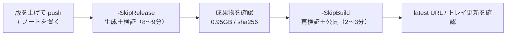

# WSL イメージ リリース実行手順（手動で流す用）

> **最初に結論:** `.\tools\build-wsl-image.ps1` を**引数なし**で実行すると、
> 生成 → 軽量化 → 圧縮 → 検証 → **GitHub Release 公開（`--latest`）** まで一気に進みます。
> 公開だけ止めたいときは **`-SkipRelease`** を付けます。初回は必ず `-SkipRelease` で通し、
> 結果に納得してから公開する、という 2 段構えを推奨します。



---

## Step 0. 事前準備（初回だけ）

```powershell
wsl --version          # 2.x であること（今回は 2.7.3 で検証）
gh auth status         # Logged in to github.com が出ること
Get-PSDrive D          # 空き 20GB 以上
```

- Inno Setup / ps2exe は不要（このスクリプトは WSL イメージ専用）
- Windows 11 必須（`wsl --import` と systemd を使うため）

## Step 1. 本体リポジトリのバージョンを上げて push

`okamoto53515606/homepage` の `package.json` の `version` を更新して push。

```powershell
# 反映確認（raw はキャッシュされるので、古ければ 1〜2 分待って再実行）
(Invoke-RestMethod 'https://raw.githubusercontent.com/okamoto53515606/homepage/main/package.json').version
```

> ここが `2.1.3` になっていないと、スクリプトは**ビルド開始前**に「バージョン不一致」で止まります
> （画面に出る版 `NEXT_PUBLIC_APP_VERSION` は `next build` 時に焼き込まれるため）。
> `-SkipVersionCheck` で回避しないでください。

## Step 2. リリースノートを置く

```text
D:\wsl_backup\homepage-release-notes-v2.1.3.md
```

- ファイル名の `2.1.3` は `package.json` の `version` と**完全一致**（`v` は付けない）
- タグは自動で `v2.1.3` になる
- 中身はそのまま Release 本文になる。`docs/update_v2.md` §6 の「押すボタン」案内を含める
- `-Version` を省略すると、このファイル名から版を自動判定する

## Step 3. 生成＋検証（公開しない）

```powershell
cd D:\work\homepage-v2-installer
.\tools\build-wsl-image.ps1 -SkipRelease
```

**所要 8〜9 分。このコマンドでは GitHub に何も作られません。**

期待するログ（抜粋）:

```text
[INFO] バージョンはリリースノートから推定: 2.1.3 (D:\wsl_backup\homepage-release-notes-v2.1.3.md)
[OK]   本体 package.json version: 2.1.3 (一致)
[OK]   ベース SHA256 検証 OK: bb415d82...
[OK]   ベースイメージを import (homepage-v2-build) 完了 (11s)
[OK]   provision.sh 完了 (246s)
[OK]   cleanup.sh 完了 (18s)
[OK]   wsl --export → D:\wsl_backup\homepage-v2-latest.tar 完了 (74s)
[OK]   pigz -9 + gzip -t 完了 (84s)
[INFO] gzip サイズ: 0.95GB / sha256: 3f73d090...
[PASS] node v24.22.2
[PASS] docker 29.9.2
[PASS] version 2.1.3 (package.json + .next)
[PASS] sudo NOPASSWD
--- all checks passed ---
[OK]   HTTP 200: setup 画面が起動しました
[WARN] リリースは -SkipRelease のためスキップ
```

## Step 4. 成果物を確認する

```powershell
Get-ChildItem D:\wsl_backup\homepage-v2-latest.tar.gz, D:\wsl_backup\homepage-v2-latest.tar.gz.sha256 |
  Select-Object Name, Length, LastWriteTime

Get-Content D:\wsl_backup\homepage-v2-latest.tar.gz.sha256      # 64 桁 1 行
(Get-FileHash D:\wsl_backup\homepage-v2-latest.tar.gz -Algorithm SHA256).Hash.ToLower()
```

見るポイント:

- サイズが **1GB 前後**（2GB を超えたらスクリプトが公開前に止めます）
- `.sha256` が**64 桁 1 行**（インストーラは先頭 64 桁を読む）
- 2 つのハッシュが一致

## Step 5. 公開（ここで初めて外部に出る）

```powershell
.\tools\build-wsl-image.ps1 -SkipBuild
```

- `-SkipBuild`: Step 3 で作った tar.gz を再利用し、**もう一度 import 検証を通してから**公開する（2〜3 分）
- 実行内容: `gh release create v2.1.3 <tar.gz> <sha256> --title v2.1.3 --notes-file <ノート> --target <main の SHA> --latest`
- `--latest` により `releases/latest/download/homepage-v2-latest.tar.gz` が新イメージに切り替わる
  → 新規インストールも、トレイの「アプリを更新」もこの版を向く
- `--target` で**ビルドしたコミット**にタグを打つ（main が進んでも版と中身がズレない）

> 最短で公開だけしたい場合は `-SkipBuild -SkipVerify` も可能ですが、
> 検証を飛ばすので非推奨（初回は必ず `-SkipBuild` まで）。

## Step 6. 公開後の確認

```powershell
gh release view v2.1.3 --repo okamoto53515606/homepage
gh release list --repo okamoto53515606/homepage --limit 3   # v2.1.3 が Latest か

curl.exe -sI -L 'https://github.com/okamoto53515606/homepage/releases/latest/download/homepage-v2-latest.tar.gz.sha256'
curl.exe -sL 'https://github.com/okamoto53515606/homepage/releases/latest/download/homepage-v2-latest.tar.gz.sha256'
```

- sha256 の URL が **200** で、内容が Step 4 のハッシュと一致
- インストーラ .exe は `latest` 追従なので**再ビルド不要**（配布済みユーザーはそのまま更新可能）
- 任意: トレイ「アプリを更新...」で「最新バージョン v2.1.3」が出ることを確認

---

## 失敗したときの後始末

| 状況 | 対処 |
|---|---|
| アップロード途中で失敗し、中途半端なリリースができた | `gh release delete v2.1.3 --repo okamoto53515606/homepage --yes --cleanup-tag` してから再実行 |
| タグだけ残ってしまった | 上記 `--cleanup-tag` で消える。手動なら `gh api -X DELETE repos/okamoto53515606/homepage/git/refs/tags/v2.1.3` |
| 誤って latest を切り替えた | `gh release edit v2.1.2 --repo okamoto53515606/homepage --latest` で戻す |
| 途中で止めた / プロンプトで固まった | `wsl --unregister homepage-v2-build` と `wsl --unregister homepage-v2-verify`。ログは `D:\wsl_backup\logs\` |
| `バージョン不一致` | `package.json` の push 忘れ、または raw のキャッシュ。1〜2 分待って再実行 |
| `リリース v2.1.3 は既に存在します` | タグは作り直せない。新しい版番号に上げる |

> **注意:** 公開後に同じ版で再実行しても、事前チェックで止まります（タグ重複）。
> 中身を作り直したいときは版番号を上げるのが原則です。

## チェックリスト

- [ ] `package.json` の version を上げて push した（raw で確認）
- [ ] `D:\wsl_backup\homepage-release-notes-v<version>.md` を置いた
- [ ] `-SkipRelease` で `verify.sh` 全 PASS / `HTTP 200` を確認した
- [ ] tar.gz が 2GB 未満、sha256 が 64 桁 1 行で一致
- [ ] `-SkipBuild` で公開した
- [ ] `releases/latest/download/...sha256` が 200 で内容一致
- [ ] ホスト側の WSL を `wsl --update` で最新化した（カーネルはイメージに含まれない）
